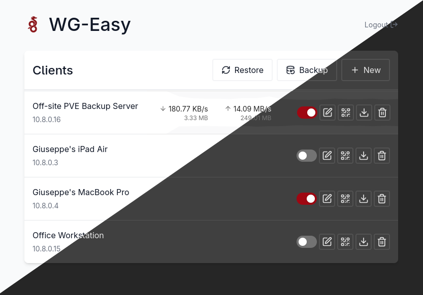

# WireGuard Easy

A refined fork of [WireGuard Easy](https://github.com/wg-easy/wg-easy) **v14** optimized for configuration management.

**Core Philosophy:** This version decouples the management UI from the WireGuard implementation. It is designed for environments—such as rootless Podman or bare-metal deployments under non-root users—where you lack the necessary privileges to manage kernel interfaces, but still require a clean, modern UI to generate and maintain your configuration.



## 🏗 Why This Fork?

* **Modern Stack:** Frontend fully rewritten in **React + TypeScript**, built with **Vite**, and styled with **Tailwind CSS**.
* **Decoupling:** By omitting the ```WG_MANAGED``` environment variable entirely, the container acts strictly as a static configuration UI. This is critical for **bare-metal users** or **rootless container environments** where the user cannot modify kernel interfaces or acquire *NET_ADMIN* capabilities.
* **Modern Networking (nftables):** Default routing and NAT rules are handled directly via nftables rather than legacy iptables. This ensures seamless compatibility with modern Linux kernels, where legacy iptables modules are effectively deprecated.

---

## 📦 Two images

| Tag | For | Inside | Runs as | Capabilities |
|---|---|---|---|---|
| `:config` (also `:latest`) | Writing the configuration of a WireGuard interface the host runs | Node and the bundled app, distroless: no shell, no package manager | UID 1000 | None |
| `:managed` | Running the interface inside the container too | The above on Alpine, plus wg-quick, wireguard-go and nftables | Root of its rootless user namespace | `NET_ADMIN` |

Neither image contains sudo or npm. Both start `node dist/lib/main.js` directly, write only to `/opt/wg`, and run on a read-only root filesystem. Keys are generated by Node itself, so a private key never appears on a command line.

Ready-made Quadlet units for both live in [`deploy/`](./deploy). To build them yourself:

```bash
podman build -t localhost/wg-easy:config .
podman build -f Containerfile.managed -t localhost/wg-easy:managed .
```

## 🏁 Quick Start

Generate the bcrypt hash of your password first, and store it as a Podman secret rather than in an environment variable, where `podman inspect` would show it:

```bash
podman run --rm ghcr.io/iomega8561/wg-easy:config /opt/wg-easy/dist/lib/wgpw.js 'YOUR_PASSWORD'
# PASSWORD_HASH='$2b$12$…'  → copy what is between the quotes
podman secret create wg-easy-password-hash -   # paste it, then Ctrl-D
```

`PASSWORD_HASH` still works for quick tests; `PASSWORD_HASH_FILE` takes precedence when both are set.

### 1. Configuration only (external WireGuard)

Use this when WireGuard is managed on the host (systemd-networkd, `wg-quick@wg0`) or when you can't grant the container any capability. Do **not** set `WG_MANAGED`.

```bash
podman run -d --name=wg-easy \
  --read-only --cap-drop=ALL --security-opt=no-new-privileges \
  --userns keep-id:uid=1000,gid=1000 \
  -e WG_HOST=<SERVER_IP> \
  -e PASSWORD_HASH_FILE=/run/secrets/wg-easy-password-hash \
  --secret wg-easy-password-hash,uid=1000,mode=0400 \
  -v ~/.wg-easy:/opt/wg:z \
  -p 3000:3000/tcp \
  ghcr.io/iomega8561/wg-easy:config
```

### 2. Managed (internal WireGuard)

The container brings `wg0` up itself. wg-quick only runs as root, so the process is root **inside its user namespace**: under rootless Podman that is your own user on the host, holding `NET_ADMIN` only within the namespace. Don't use `--userns keep-id` here, and load the `wireguard` kernel module on the host beforehand: a user namespace can't load modules, and without it wg-quick falls back to wireguard-go.

```bash
podman run -d --name=wg-easy \
  --read-only --cap-drop=ALL --cap-add=NET_ADMIN --security-opt=no-new-privileges \
  --device /dev/net/tun \
  --sysctl net.ipv4.ip_forward=1 \
  --sysctl net.ipv4.conf.all.src_valid_mark=1 \
  -e WG_HOST=<SERVER_IP> \
  -e WG_MANAGED=true \
  -e PASSWORD_HASH_FILE=/run/secrets/wg-easy-password-hash \
  --secret wg-easy-password-hash,mode=0400 \
  -v ~/.wg-easy:/opt/wg:Z \
  -p 3000:3000/tcp \
  -p 51820:51820/udp \
  ghcr.io/iomega8561/wg-easy:managed
```

### Upgrading from the single image

- `:latest` is now the configuration-only image. If you ran it with `WG_MANAGED`, switch to `:managed`.
- In managed mode, drop `--userns keep-id`: the image no longer has sudo, and wg-quick needs to start as root. Files already in `~/.wg-easy` belong to your user, which is root inside the container, so they need no change.
- `wgpw` is now `/opt/wg-easy/dist/lib/wgpw.js`, run as shown above.

---

## ⚖️ Credits

Based on [WireGuard Easy](https://github.com/wg-easy/wg-easy) by **WeeJeWel**. Licensed under CC BY-NC-SA 4.0.
